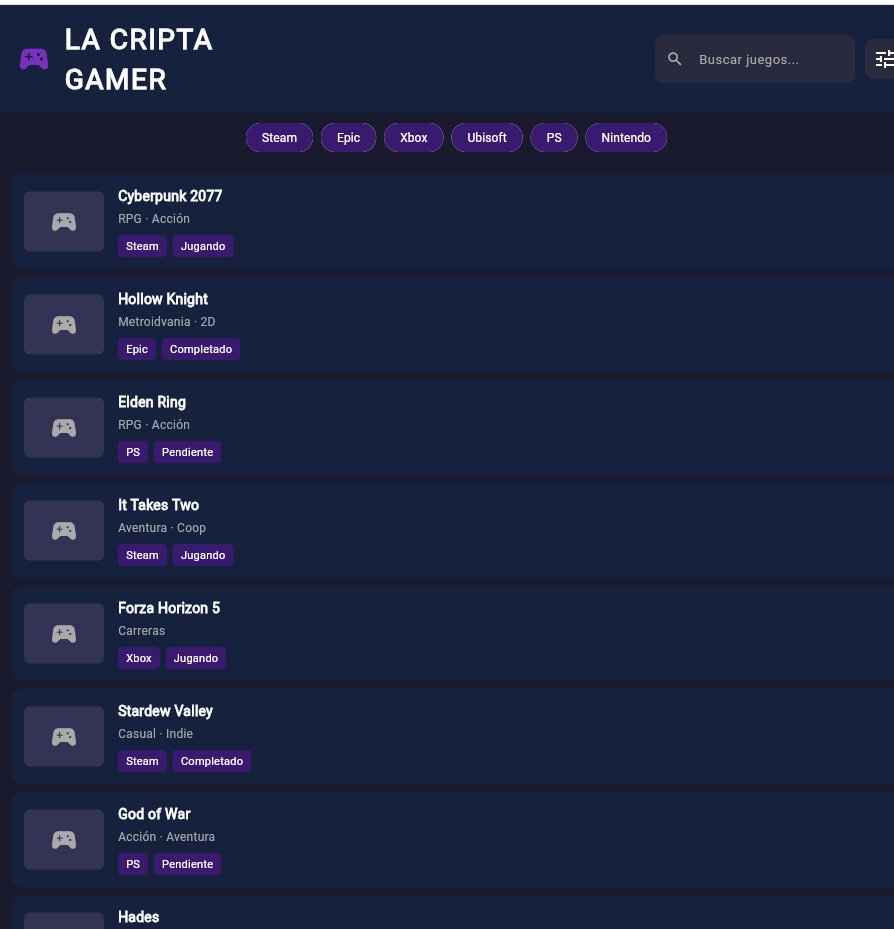
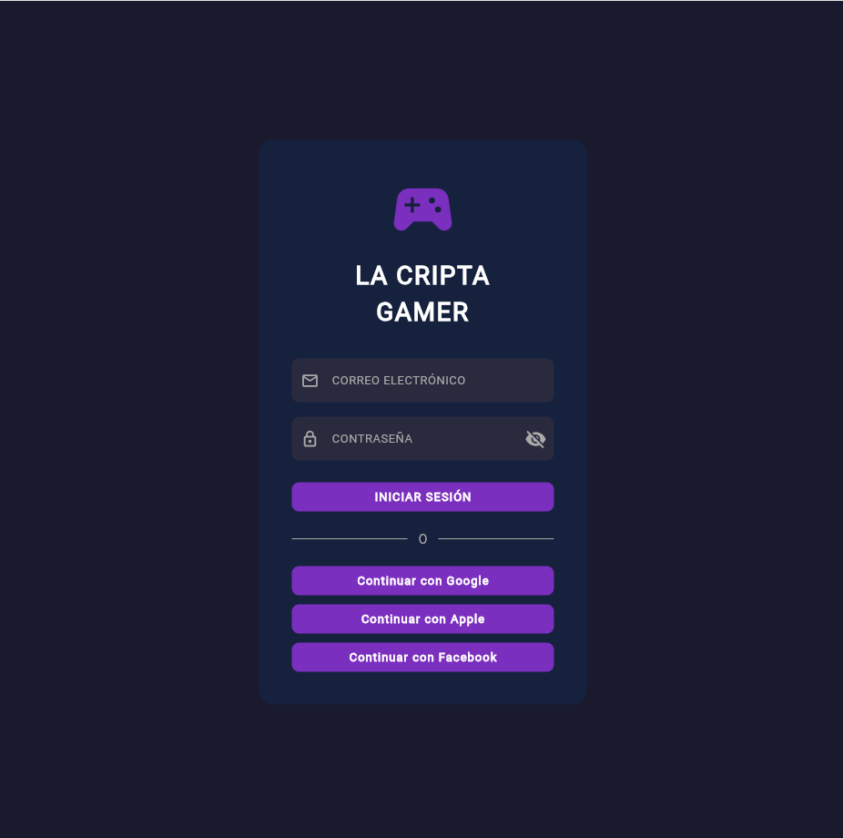
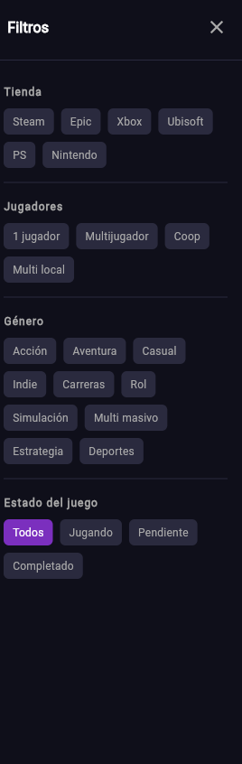

# 🎮 La Cripta Gamer

<p align="center">
  
</p>

<p align="center">
  <strong>Plataforma Unificada de Gestión de Bibliotecas de Videojuegos Multi-Tienda y Detección en Tiempo Real</strong>
</p>

<p align="center">
  
  
  
  
  
  
</p>

---

## 📌 Tabla de Contenidos

1. [Descripción del Proyecto](#-descripción-del-proyecto)
2. [Problemática y Propuesta de Valor](#-problemática-y-propuesta-de-valor)
3. [Características Principales](#-características-principales)
4. [Galería de Pantallas](#-galería-de-pantallas)
5. [Arquitectura de Software](#-arquitectura-de-software)
6. [Stack Tecnológico](#-stack-tecnológico)
7. [Guía de Instalación y Ejecución](#-guía-de-instalación-y-ejecución)
8. [Integraciones Externas](#-integraciones-externas)
9. [Estructura del Repositorio](#-estructura-del-repositorio)
10. [Información Institucional y Autores](#-información-institucional-y-autores)

---

## 📖 Descripción del Proyecto

**La Cripta Gamer** es una aplicación cliente multiplataforma desarrollada en **Flutter y Dart**, concebida para actuar como un concentrador visual y gestor centralizado de videojuegos. Su objetivo es unificar en una única interfaz estética y ergonómica los títulos que los jugadores poseen dispersos en múltiples plataformas digitales (*Steam, Epic Games Store, Xbox App, PlayStation Network, Nintendo eShop y ejecutables de PC*).

La solución cuenta con **detección en tiempo real de videojuegos en ejecución en Windows** (originales y copias locales/repacks), integración con la **Web API de Valve Steam**, consulta al catálogo global de **RAWG** (más de 500.000 videojuegos) y un sistema reactivo de búsqueda y filtrado multidimensional en memoria.

---

## 🎯 Problemática y Propuesta de Valor

* **La Problemática:** Los jugadores de PC y consolas enfrentan el fenómeno del *"backlog fragmentado"*. Con juegos repartidos entre múltiples lanzadores cerrados, es frecuente perder tiempo buscando en qué tienda se encuentra un juego, comprar títulos por duplicado de manera accidental o tener dificultades para decidir a qué jugar con amigos en sesiones multijugador.
* **La Propuesta de Valor:** Una experiencia de usuario *"Dark Gamer"* rápida, libre de distracciones y con baja fatiga visual. Permite organizar el progreso personal (*Jugando*, *Pendiente*, *Completado*), buscar con filtrado instantáneo $\mathcal{O}(N)$ y visualizar automáticamente qué juego se está ejecutando en la máquina en ese instante exacto.

---

## ✨ Características Principales

* 🎮 **Biblioteca Unificada:** Catálogo con tarjetas interactivas que exhiben portadas oficiales en alta resolución (vía CDN de Steam y RAWG), badges de tienda, notas de Metacritic y estado de progreso.
* 🟢 **Detección de Juegos en Vivo (Live Detection):**
  * **Inspección de procesos en Windows:** Detección en segundo plano vía PowerShell `(Get-Process)` para identificar qué juego está abierto en la PC.
  * **Lectura local de Steam:** Reconocimiento dinámico de juegos instalados leyendo los archivos `appmanifest_*.acf` de `steamapps`.
  * **Base de firmas de más de 100 juegos:** Soporte para títulos AAA, juegos independientes y variantes de repacks (*FitGirl, DODI, Codex*: GTA V, Cyberpunk 2077, Resident Evil 4, Elden Ring, Left 4 Dead 2, etc.).
  * **Heurística de Unreal Engine:** Detección de ejecutables terminados en `-win64-shipping` o `_shipping`.
* 🌍 **Explorador del Catálogo Mundial (RAWG API):**
  * Pestaña dedicada para buscar en la base de datos de más de 500.000 títulos.
  * Posibilidad de añadir cualquier juego descubierto a la biblioteca personal con un solo clic.
* ⚡ **Búsqueda Predictiva y Filtrado Multidimensional:**
  * Búsqueda en tiempo real insensible a mayúsculas/minúsculas al escribir.
  * Chips superiores para alternar rápidamente entre tiendas (*Steam, Epic, Xbox, PS, Nintendo, Ubisoft*).
  * Panel lateral desplegable (*Drawer* animado con `SlideTransition`) para segmentar por modalidad (*1 jugador, Coop, Multijugador*) y estado de juego.
* 🎨 **Diseño UI/UX "Show Don't Tell":**
  * Paleta de colores temáticos con fondo oscuro `#1A1A2E` y acento púrpura neón `#7B2FBE`.
  * Contraste verificado bajo el estándar **WCAG 2.1** (ratio de 15.4:1 nivel AAA en texto principal).
  * Microinteracciones con animación de elevación cromática (*hover* de 150ms).
* ⚙️ **Centro de Sincronización:**
  * Importación con 1 clic de juegos instalados localmente.
  * Conexión con Steam Web API vía SteamID64.
  * Modo de simulación rápida en 1 clic (*Cyberpunk 2077, Hollow Knight, CS2*) para defensas académicas.

---

## 🖼 Galería de Pantallas

<table align="center" width="100%">
  <tr>
    <td align="center" width="33%">
      
      <br /><strong>Figura 1:</strong> <em>Inicio de Sesión con Validación</em>
    </td>
    <td align="center" width="33%">
      
      <br /><strong>Figura 2:</strong> <em>Biblioteca y Banner "En Vivo"</em>
    </td>
    <td align="center" width="33%">
      
      <br /><strong>Figura 3:</strong> <em>Drawer Lateral de Filtros Avanzados</em>
    </td>
  </tr>
</table>

---

## 🏗 Arquitectura de Software

El código sigue un patrón en capas con separación rigurosa de responsabilidades:

```
lib/
├── data/
│   └── game_data.dart              # Modelo inmutable 'Juego', serializadores JSON y datos iniciales
├── services/
│   ├── rawg_service.dart           # Cliente REST para la API de RAWG Video Games Database
│   ├── steam_service.dart          # Integración con Valve Steam Web API y túnel CORS
│   ├── local_process_service.dart  # Lector de appmanifest locales y escáner de procesos Windows
│   └── game_aggregator.dart        # Orquestador central (ChangeNotifier Singleton + Timer en 2.º plano)
├── screens/
│   ├── login_screen.dart           # Vista de inicio de sesión con validación de credenciales
│   └── biblioteca_screen.dart      # Vista principal, tabs de catálogo, buscador, chips y modal de ajustes
├── widgets/
│   └── game_card.dart              # Componente de tarjeta con carátula HD, badges y feedback hover
├── theme.dart                      # Definición de tokens de color (AppColors) y estilos tipográficos
└── main.dart                       # Punto de entrada de la aplicación Flutter (MaterialApp)
```

### Principios de Ingeniería Aplicados
1. **Inmutabilidad en el Dominio:** La clase `Juego` está marcada con `@immutable` y constructor `const`, garantizando un consumo seguro en memoria y facilitando el recolector de basura de Dart.
2. **Gestión de Estado Reactiva:** Implementada mediante el patrón `ChangeNotifier` en `GameAggregator`. Al detectarse un cambio en el sistema operativo o en una petición web, la interfaz reacciona instantáneamente sin re-renderizar componentes innecesarios.
3. **Resiliencia y Modo Offline:** Si no hay conexión a internet o no se proveen claves de API, la aplicación funciona de forma transparente utilizando la colección local y los juegos instalados en el disco.

---

## 💻 Stack Tecnológico

| Herramienta / Tecnología | Versión | Rol en el Proyecto |
| :--- | :---: | :--- |
| **Flutter SDK** | 3.x | Framework de desarrollo multiplataforma (Web & Windows Desktop). |
| **Dart** | 3.x | Lenguaje de programación fuertemente tipado con *Sound Null Safety*. |
| **Material Design 3** | Latest | Base de componentes adaptada a la temática personalizada *Dark Gamer*. |
| **Package `http`** | 1.6.0 | Consumo asíncrono de APIs REST (RAWG y Steam Web API). |
| **Python** | 3.x | Servidor auxiliar ultraligero (`monitor_pc.py`) para el túnel de procesos locales en Web. |
| **Git & GitHub** | Latest | Control de versiones y alojamiento del repositorio público oficial. |

---

## 🚀 Guía de Instalación y Ejecución

### Prerrequisitos
* [Flutter SDK](https://docs.flutter.dev/get-started/install/windows) (versión 3.19 o superior configurada en el `PATH`).
* [Git](https://git-scm.com/) instalado.
* Python 3.x (opcional, utilizado para el monitor de procesos locales cuando se corre en navegador Web).

### 1. Clonar el repositorio
```bash
git clone https://github.com/Lanternest/LaCriptaGamer.git
cd LaCriptaGamer/la_cripta_gamer
```

### 2. Descargar las dependencias
```bash
flutter pub get
```

### 3. Ejecución

#### Opción A: En Microsoft Edge / Chrome (Recomendada y rápida)
Puedes iniciar la app con el lanzador de 1 clic:
* **Hacer doble clic en:** `iniciar_cripta.bat`
* O desde la terminal:
```powershell
python monitor_pc.py
flutter run -d edge
```

#### Opción B: Como aplicación nativa de escritorio de Windows (.exe)
*(Requiere tener instalado Visual Studio 2022 con la carga de trabajo "Desarrollo para el escritorio con C++")*
```powershell
flutter run -d windows
```

### 🔑 Credenciales de Demostración para el Login
* **Correo:** `gamer@cripta.com`
* **Contraseña:** `1234`

---

## 🔌 Integraciones Externas

### 1. Importación Local de Steam (Sin necesidad de claves)
Al presionar el botón de ajustes (icono ⇄ en la barra superior), se encuentra disponible el botón:
* **"📥 Importar Juegos Instalados"**: Lee directamente los manifiestos de instalación de Steam en el disco local (`C:\Program Files (x86)\Steam\steamapps`) e importa automáticamente los títulos con sus portadas oficiales en milisegundos.

### 2. Valve Steam Web API
* Permite sincronizar la colección completa en la nube e inspeccionar el estado en vivo a través del campo `gameextrainfo`.
* **Cómo obtener la API Key gratuita:**
  1. Ingresar en [steamcommunity.com/dev/apikey](https://steamcommunity.com/dev/apikey).
  2. Escribir `localhost` en el nombre de dominio y presionar *Register*.
  3. Copiar la clave alfanumérica y pegarla en la configuración de la app junto con el SteamID64.
  *Nota:* El perfil de Steam debe tener configurada la opción *"Detalles de los juegos"* en **Público** en las opciones de privacidad de Steam.

### 3. RAWG Video Games Database
* Conectado mediante clave REST para consultar carátulas en alta definición, géneros oficiales, fechas de lanzamiento y puntajes de Metacritic.

---

## 🏛 Información Institucional y Autores

* **Institución:** Instituto de Educación Superior Manuel Belgrano (IESMB)
* **Carrera:** Tecnicatura Superior en Desarrollo de Software (3.º Año)
* **Espacio Curricular:** Arquitectura y Diseño de Interfaces
* **Instancia:** Examen Final / 2.º Examen Parcial · Ciclo Lectivo 2025 / 2026

### Desarrolladores
* **Gustavo Emanuel Lautaro Salvi**
* **Leandro Damián Chiarello**

---

<p align="center">
  <em>Desarrollado con dedicación para el Examen Final de Arquitectura y Diseño de Interfaces · IESMB 2025/2026</em>
</p>
